  
  

    
    
  

---

### 🧰 Tech Stack

<strong>Languages</strong>

  

<strong>Frontend</strong>

  

<strong>Backend &amp; data</strong>

  

<strong>AI &amp; hardware</strong>

  

<strong>Tools &amp; deployment</strong>

  

---

  <picture>
    <source media="(prefers-color-scheme: dark)" srcset="https://raw.githubusercontent.com/HLCLJacksonC/HLCLJacksonC/output/github-snake-dark.svg" />
    
  </picture>

<!-- Layout inspired by https://github.com/zhouyuanxinand; banner independently drawn. Icons: https://skillicons.dev; animation: https://github.com/Platane/snk. -->
